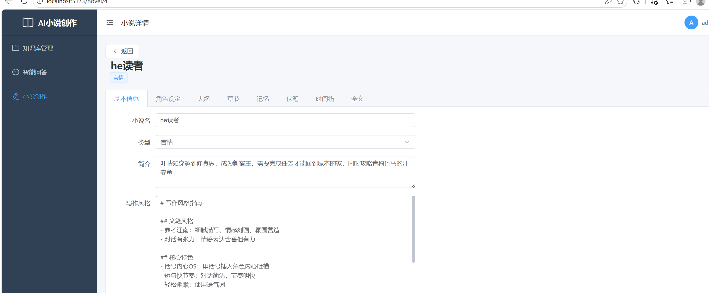
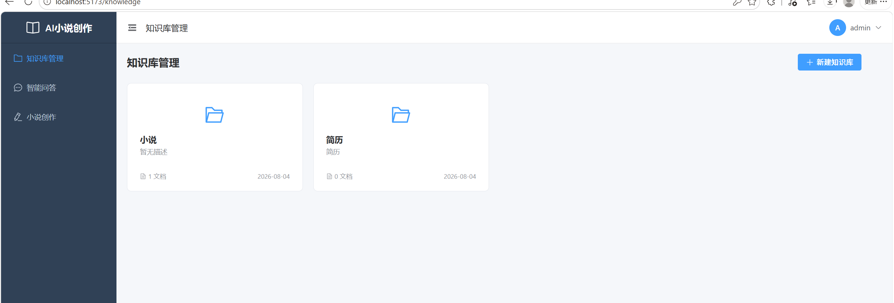
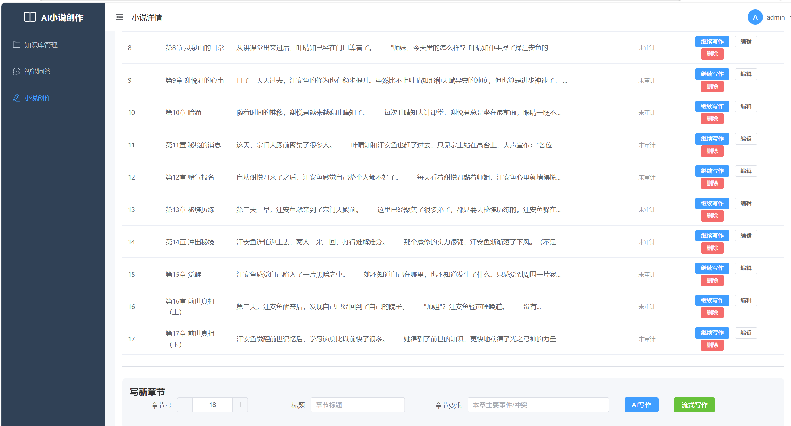
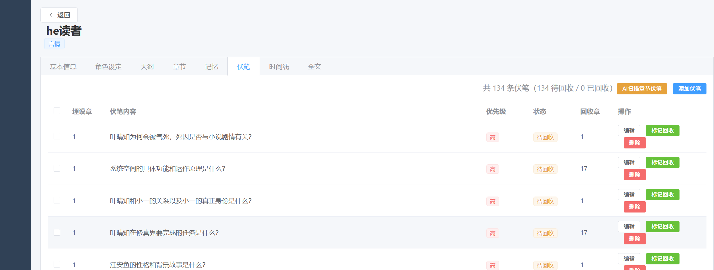
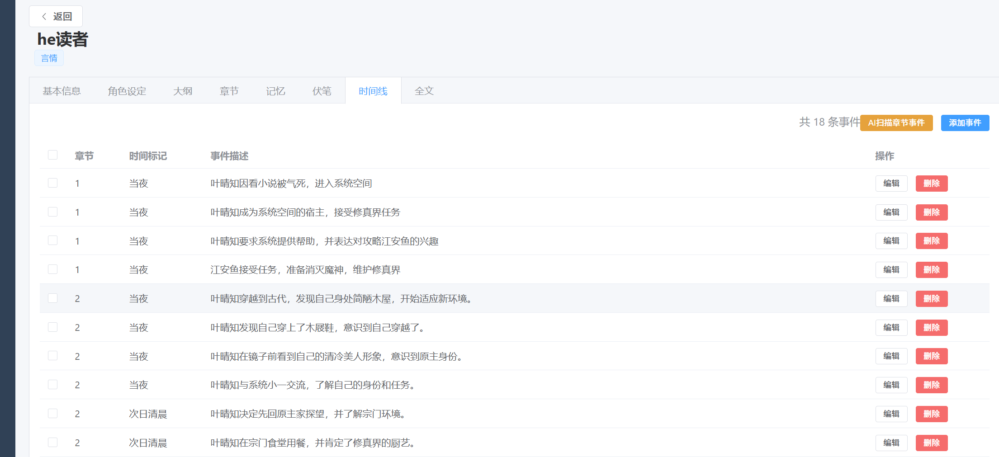
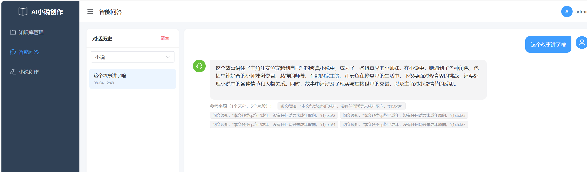

# AI 小说创作平台

基于 RAG + LLM 的智能小说创作辅助系统，集成 AI 写作、角色管理、伏笔追踪、时间线管理、质量审计等功能，并内置完整的 RAG 知识库问答引擎。

## 效果展示

> 截图位于 `screenshots/` 目录，可在仓库中直接查看。

| 系统整体框架 | 登录页 |
|:---:|:---:|
|  |  |

| AI 章节生成 | 伏笔追踪 |
|:---:|:---:|
|  |  |

| 时间线管理 | RAG 智能问答 |
|:---:|:---:|
|  |  |

## 技术栈

### 后端
- **FastAPI** — 异步 Web 框架，支持流式输出（SSE）
- **SQLAlchemy + MySQL** — ORM 与关系型数据库
- **PyMySQL** — MySQL 驱动
- **PyJWT + bcrypt** — JWT 认证与密码加密
- **httpx** — 异步调用智谱 LLM API

### RAG 引擎
- **FAISS (faiss-cpu)** — 向量检索引擎
- **sentence-transformers (bge-small-zh-v1.5)** — 本地 Embedding 模型
- **jieba** — 中文分词，用于 BM25 关键词检索
- **RRF 融合算法** — 向量检索 + BM25 混合召回
- **Cross-Encoder Rerank** — 重排序优化检索精度
- **查询改写 / Multi-Query** — 提升召回率
- **RAGAS 评估体系** — 忠实度 / 相关性 / 精确率 / 召回率

### 前端
- **Vue 3 (Composition API)** — 渐进式前端框架
- **Element Plus** — UI 组件库
- **Vite** — 构建工具
- **Axios** — HTTP 请求，拦截器统一处理鉴权与错误
- **Pinia** — 状态管理

### AI / LLM
- **智谱 GLM-4 / GLM-4-Flash / GLM-4-Air** — 成本感知路由，按任务复杂度选模型
- **章节质量审计** — 8 维度自动评分 + AI 腔检测
- **上下文分层组装** — 按优先级管理 Token 预算

## 核心功能

### 小说创作引擎
- **AI 章节生成** — 基于大纲、角色设定、上下文记忆流式生成章节正文
- **写后质量审计** — 8 维度评分（必需节拍、叙事进展、角色进展等），分数 < 70 自动重写
- **AI 腔检测** — 15 项模式匹配，检测"突然之间"、"不禁"等 AI 写作痕迹
- **上下文分层组装** — P0 必选 / P1 重要 / P2 可选，超 Token 按优先级截断
- **成本感知路由** — 简单任务用 glm-4-flash，复杂任务用 glm-4

### 角色与状态管理
- **角色设定 CRUD** — 姓名、性格、背景、关系网络
- **角色状态热更新** — 章节生成后 AI 自动提取位置/实力/心情/持有物品变更
- **AI 角色提取** — 从章节正文自动识别新角色

### 伏笔追踪系统
- **伏笔 CRUD + 批量操作** — 批量删除、批量标记回收
- **AI 扫描提取** — 自动扫描章节，提取新伏笔并检查回收状态
- **状态管理** — pending / resolved / abandoned

### 时间线管理
- **事件 CRUD + 批量删除**
- **AI 自动提取** — 章节生成后自动提取重大事件

### RAG 知识库问答
- **文档上传** — 支持 PDF / TXT / MD
- **混合检索** — FAISS 向量检索 + BM25 关键词检索 + RRF 融合
- **Rerank 重排序** — Cross-Encoder 精排
- **查询改写** — Query Rewriting + Multi-Query 扩展
- **RAGAS 评估** — 自动评估检索质量
- **流式问答** — SSE 实时输出

### 其他功能
- **文风学习** — 分析参考文本，生成写作风格指南
- **分卷规划** — AI 生成分卷大纲
- **情绪曲线** — 分析章节情绪强度，可视化叙事节奏
- **版本归档** — 小说快照管理，支持断点续写
- **全局记忆 / 章节记忆** — 分层记忆管理

## 项目结构

```
项目三/
├── main.py                  # FastAPI 入口
├── config.py                # 配置（API Key、模型路由、数据库）
├── database.py              # 数据库初始化与迁移
├── security.py              # JWT 认证
├── core/
│   ├── novel_engine.py      # 小说创作引擎（上下文组装、审计、伏笔扫描）
│   ├── novel_llm_client.py  # LLM 调用（智谱/混元，成本感知路由）
│   ├── llm_client.py        # 通用 LLM 调用
│   ├── rag_engine.py        # RAG 引擎（混合检索 + Rerank + 查询改写）
│   ├── rag_evaluation.py    # RAGAS 评估体系
│   ├── observability.py     # 可观测性（请求追踪、安全审计）
│   ├── embeddings.py        # Embedding 服务
│   ├── vector_store.py      # FAISS 向量存储
│   └── text_splitter.py     # 文档分块
├── models/
│   ├── novel.py             # 小说数据模型（Novel/Chapter/Character/Foreshadowing/Timeline/Version）
│   ├── user.py              # 用户模型
│   ├── knowledge.py         # 知识库模型
│   └── schemas.py           # Pydantic 请求/响应模型
├── routers/
│   ├── novel.py             # 小说创作 API
│   ├── knowledge.py         # 知识库 API
│   └── chat.py              # 问答 API
└── frontend/
    ├── src/
    │   ├── views/           # 页面（Login/NovelList/NovelDetail/Chat/KnowledgeList）
    │   ├── api/             # API 请求封装
    │   ├── layouts/         # 布局组件
    │   └── router/          # Vue Router
    ├── index.html
    └── vite.config.js
```

## 快速启动

### 环境要求
- Python 3.10+
- Node.js 18+
- MySQL 8.0+

### 后端

```bash
# 1. 安装依赖
pip install -r requirements.txt

# 2. 配置环境变量
cp .env.example .env
# 编辑 .env，填入智谱 API Key 和 MySQL 连接信息

# 3. 启动后端
python main.py
# 后端运行在 http://localhost:8000
```

### 前端

```bash
cd frontend

# 安装依赖
npm install

# 启动开发服务器
npm run dev
# 前端运行在 http://localhost:5173
```

### 数据库

确保 MySQL 已启动，创建数据库：

```sql
CREATE DATABASE rag_knowledge_base CHARACTER SET utf8mb4 COLLATE utf8mb4_unicode_ci;
```

应用启动时会自动创建数据表。

## 系统架构

```
┌─────────────┐     ┌──────────────────────────────────────────┐
│   Vue 3     │────▶│              FastAPI 后端                 │
│  前端页面    │ SSE│                                          │
└─────────────┘     ├──────────────┬──────────────┬────────────┤
                    │  小说创作引擎  │   RAG 引擎    │  认证模块   │
                    │              │              │            │
                    │ ·上下文组装   │ ·混合检索     │ ·JWT 鉴权   │
                    │ ·质量审计     │ ·Rerank      │ ·密码加密   │
                    │ ·伏笔追踪     │ ·查询改写     │            │
                    │ ·角色状态     │ ·RAGAS评估    │            │
                    └──────┬───────└──────┬───────┴────────────┘
                           │              │
                    ┌──────▼──────┐ ┌─────▼──────┐
                    │  智谱 LLM   │ │  MySQL     │
                    │  GLM-4系列  │ │  数据持久化  │
                    └─────────────┘ └────────────┘
```
